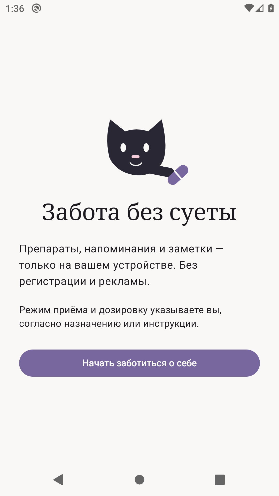
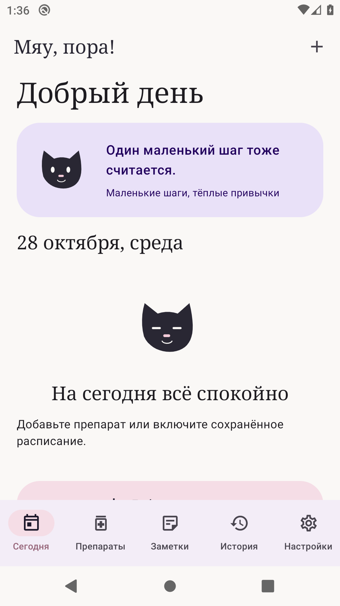
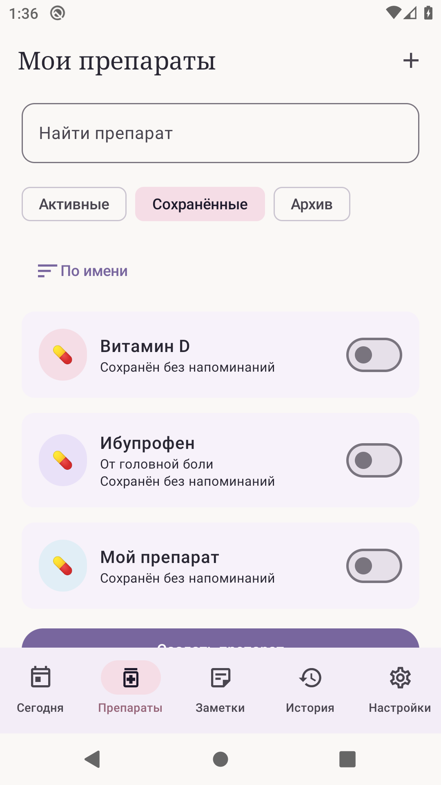
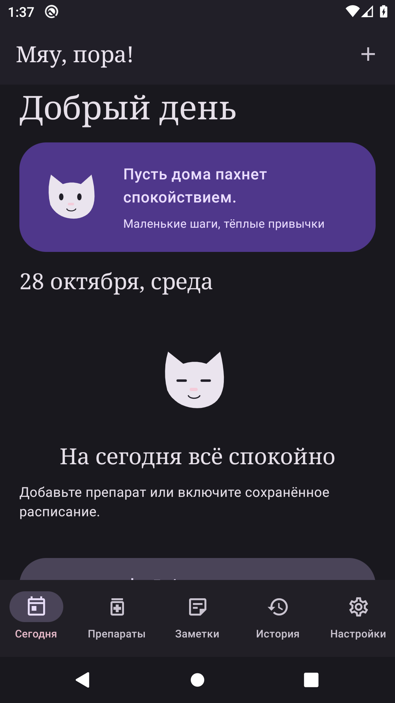

# Мяу, пора! 🐾

Нативный локальный Android-помощник для напоминаний о препаратах и личных заметок. Интерфейс на русском. Разработчик **L**.

## Реальные экраны

Скриншоты запущенного приложения на эмуляторе Android 10, не макеты.

 

 

## Возможности

- Jetpack Compose / Material 3, системные цвета Material You на Android 12+, светлая/тёмная/системная тема, четыре ручных акцента.
- Минималистичный векторный котик с таблеткой, собственная адаптивная иконка, короткая анимация при запуске.
- Сегодня: приветствие, добрая фраза, ближайший приём, список дня, быстрые отметки.
- Независимая библиотека препаратов: описание, пользовательская дозировка, заметка, оформление, поиск, сортировка, избранное, архив, дублирование, несколько именованных расписаний.
- Однократные, ежедневные, еженедельные и ежемесячные правила с интервалом N, несколькими временами, датой начала, последним днём месяца и вариантом пропуска короткого месяца.
- Бессрочно, до даты или заданное число запланированных приёмов; предпросмотр десяти следующих срабатываний и даты последнего для конечного счётчика.
- AlarmManager, точный/неточный режим, восстановление после перезагрузки и смены времени, ограниченные дополнительные уведомления, действия «Принято», «Отложить», «Пропустить».
- История с календарным выбором дня, фильтром по препарату и исправлением статуса. Аудит изменений сохраняется.
- 108 встроенных русских фраз, шесть категорий, учёт времени суток, исключение последних 20 фраз, свои фразы.
- Заметки: свободный текст, чек-листы, цвета, закрепление, архив, поиск, автоматическое сохранение. Нет программных лимитов количества заметок или длины текста; практические пределы определяются памятью устройства и SQLite.
- Экспорт/импорт JSON, объединение без дублей по ID, подтверждённая полная замена/сброс.
- Никаких серверов, регистрации, рекламы, трекеров и разрешения INTERNET. Напоминания примеров при первом запуске выключены. Медицинские дозировки не предзаполнены.

## Получить APK

Первая проверенная тестовая сборка: [скачать APK из Releases](https://github.com/luwili/meow-reminder-android/releases/tag/v1.0.0-debug). Репозиторий приватный: войдите в свой аккаунт GitHub.

Последующие автоматические сборки: **Actions → Android · APK и тесты → успешный запуск → Artifacts → meow-reminder-debug-apk**. Распакуйте ZIP и установите `app-debug.apk`. Для скачивания из приватного репозитория нужна авторизация владельца/участника.

Либо после `gh auth login`: `bash scripts/get-apk.sh` (скачивает APK последней успешной сборки).

На телефоне разрешите установку из выбранного файлового менеджера, установите APK, откройте приложение и разрешите уведомления. В настройках приложения проверьте доступ к точным будильникам. Без него Android может задерживать напоминания. Проверьте тестовое уведомление и создайте собственное расписание. Примеры находятся в разделе **Препараты → Сохранённые**.

Debug APK подписан стандартным тестовым ключом. Ключ GitHub runner может отличаться от локального: обновление такой сборки иногда требует удаления старой версии. **Сначала экспортируйте данные.** Для постоянного распространения нужен собственный безопасно хранимый release-ключ; ключи/пароли не входят в репозиторий.

## Сборка в Android Studio / CLI

Требуется JDK 21 (байткод 17), Android SDK platform 36, build-tools 36.0.0, интернет только для загрузки зависимостей при сборке. Минимум Android 8.0 / API 26, target API 36.

```bash
export ANDROID_HOME=/path/to/Android/Sdk
./gradlew testDebugUnitTest lintDebug assembleDebug assembleDebugAndroidTest
# При подключённом устройстве/эмуляторе:
./gradlew connectedDebugAndroidTest
```

APK: `app/build/outputs/apk/debug/app-debug.apk`. Отчёты: `app/build/reports/`.

Откройте корень проекта в Android Studio, укажите SDK и Gradle JDK 21. В репозитории есть Gradle Wrapper. `local.properties` с вашим `sdk.dir` не коммитится.

## Стек и структура

Kotlin 2.2.21, AGP 8.13.2, Gradle 8.13, Compose BOM 2025.12.00, Room 2.8.4, DataStore 1.2, Navigation Compose, WorkManager, Coroutines / Flow, kotlinx.serialization.

```text
app/src/main/java/ru/meow/reminder/
  data/        Room, DataStore, backup, сущности и фразы
  domain/      чистая календарная логика
  reminders/   AlarmManager, уведомления, получатели, repair worker
  ui/          MVVM, Material You, навигация и экраны
app/src/test/         календарные unit-тесты
app/src/androidTest/  Room, планировщик, backup и Compose smoke test
```

Подробности: [архитектура и календарные правила](docs/ARCHITECTURE.md).

Проверки: [результаты тестов и границы проверки](docs/TESTING.md), [чек-лист реального телефона](docs/DEVICE_CHECKLIST.md).

## Шрифт

Запрошенный **Anthropic Serif Web** не включён: файл и лицензия на встраивание/распространение пользователем не предоставлены. Вместо нелицензированного копирования с чужого сайта в заголовки встроен **Noto Serif**, включая кириллицу, по SIL OFL (см. `licenses/NotoSerif-OFL.txt`). Это замена, а не Anthropic Serif. Основной текст — системный хорошо читаемый sans-serif. После предоставления лицензированного файла шрифт можно заменить в `ui/Theme.kt`.

## Ограничения и безопасность

- Не медицинское изделие, не назначает лечение и не обещает абсолютную точность Android-уведомлений.
- Doze, батарейные ограничения производителя, отключённый канал, отказ в уведомлениях и принудительная остановка могут мешать доставке. После force-stop приложение нужно открыть вручную.
- После простоя не отправляет пачку старых напоминаний: они остаются неподтверждёнными в истории.
- Время — местное системное. При DST отсутствующее время сдвигается вперёд, повторяющееся используется один раз.
- Заметки похожи по базовому подходу на Keep, но не включают облачную синхронизацию, совместное редактирование, изображения или голосовые вложения.
- JSON содержит незашифрованные личные данные. База защищена изоляцией Android, отдельного пароля/шифрования БД нет.
- Политики Doze/OEM и долгую работу после перезагрузок нужно дополнительно проверить на реальном телефоне. Наличие автоматических тестов не заменяет такую проверку.
